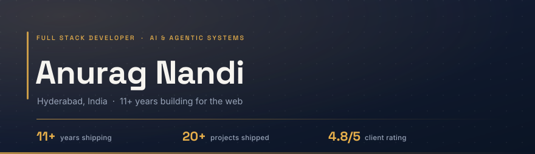

<!-- ───────────────────────────────────────────────────────────── -->
<!--  Anurag Nandi · profile README                                -->
<!--  Art: assets/hero.svg + assets/rule.svg (text rendered as      -->
<!--  paths, so nothing depends on the viewer's fonts).             -->
<!-- ───────────────────────────────────────────────────────────── -->

  

I'm a full stack developer in Hyderabad, eleven years in.

By day I lead UI engineering at **NextEra AI**, shipping enterprise energy products end to end: React and Next.js on the front, Node and NestJS behind it, MongoDB underneath. On my own time I run **BigBear Software**, the studio that built **DocPilot**, an AI copilot now used in Indian clinics.

Most of what I build is agentic AI sitting inside real products: morning briefings, chart summaries, workflow automation. The interesting part was never the model. It's the guardrails that make it safe to hand a doctor at 9am.

### What I'm on right now

<table>
<tr>
<td width="34%" valign="top"><b>NextEra AI (EIQ Digital)</b> UI Lead · Feb 2025 to present</td>
<td>Enterprise energy tooling for utility clients: EV charger management wizards, plan comparison flows, admin dashboards. I also took the product off the browser and into Chrome extensions and cross-platform apps, including their auth and data sync layers. Teams in Australia, the US and Singapore, with me as the point where design, product and backend meet.</td>
</tr>
<tr>
<td valign="top"><b>BigBear Software</b> Founder · 2024 to present</td>
<td>A product studio in Hyderabad. DocPilot gets a prescription out in about 30 seconds and lands it on the patient's WhatsApp. BuildCore AI brings live material pricing and site operations to construction, still in development. <i>Reliable software. Real impact. Made in India.</i></td>
</tr>
<tr>
<td valign="top"><b>Hermes</b> Personal build · 2025 to present</td>
<td>An LLM agent on a schedule that reads my day, checks its own inputs before speaking, and stays quiet when it doesn't know something. Most agents fail by sounding confident. This one was built the other way round.</td>
</tr>
</table>

### Things I shipped

<table>
<tr>
<th width="17%" align="left">Project</th>
<th width="58%" align="left">What it is</th>
<th width="25%" align="left">Built with</th>
</tr>
<tr>
<td><b>DocPilot</b> 2025</td>
<td>AI copilot for Indian clinics. Prescriptions in about 30 seconds, WhatsApp delivery, a morning briefing that reads the day back to the doctor, charts summarised in seconds. Summaries stay summaries: nothing diagnoses, and the deterministic product works with the AI switched off.</td>
<td>React · Node · MongoDB LLM APIs · Vercel</td>
</tr>
<tr>
<td><b>BuildCore AI</b> 2026</td>
<td>Construction intelligence: live material pricing, site attendance and project management on one foundation.</td>
<td>In development BigBear Software</td>
</tr>
<tr>
<td><b>Enterprise energy suite</b> 2025</td>
<td>EV charger wizards, plan comparison and admin dashboards for US utility clients, under NDA.</td>
<td>Next.js · NestJS · MongoDB</td>
</tr>
<tr>
<td><b>Workforce platform</b> 2021 to 2023</td>
<td>A 100+ page platform for employee management, payroll, time entry and scheduling. Employee profiles with hundreds of fields, validation rules and time-zone-aware shifts.</td>
<td>React · GraphQL Node · FullCalendar</td>
</tr>
<tr>
<td><b>PuppyPi</b> 2026</td>
<td>Raspberry Pi quadruped with a voice and vision pipeline. A good way to find out which parts of AI are actually hard.</td>
<td>Python · OpenCV LLM APIs</td>
</tr>
<tr>
<td><b>Client work</b> 2023 to 2025</td>
<td>Valerian Legal Consulting, Indian Table in Brooklyn, MoonDrive Cars, ZPHS Locator. Twenty-plus client projects across e-commerce, SaaS and internal tools, at a 4.8/5 average rating.</td>
<td>React · Next.js · Node Three.js · Sanity</td>
</tr>
</table>

### How I work

**I own the whole path.** Data model, API, interface, deploy. A design handoff is the start of the work, not the edge of it.

**Guardrails before demos.** An AI feature is ready when it's still safe at 3am with a tired user on the other end. Anything I ship keeps working when the model doesn't.

**Numbers before arguments.** I instrument analytics before launch, then let the traffic settle the disagreement. I've cut load times and lifted search visibility that way, not by opinion.

### Toolkit

**Frontend** · TypeScript, React, Next.js, Remix and React Router, React Native, Tailwind, Mantine, shadcn/ui, Ant Design, Figma 
**Backend** · Node, Express, NestJS, GraphQL, REST, Socket.IO, JWT, WebAuthn, Zod, ASP.NET 
**Data** · MongoDB, PostgreSQL, Prisma, Redis, Supabase, Sanity, Strapi 
**AI** · LLM integration, prompt design and evaluation, agentic workflows, guardrails, summarisation. Claude Code and Codex are part of my daily loop, not a demo. 
**Ship** · AWS, Vercel, Docker, Vite, Git, Cloudinary, BigCommerce, Google Analytics

### The long way round

Sharjah, 2017: SEO and paid campaigns for a steel company, where I sold their biggest contract of the quarter and lifted revenue 7% in a year. Montreal, 2021: frontend on a payroll platform, learning GraphQL properly. Hyderabad, 2025: UI Lead and founder at the same time. Eleven years since the first freelance invoice, and I still like the work more than I like talking about it.

### Find me

**Hyderabad, India.** Open to full stack and AI engineering work, and always up for a hard product problem.

[anuragnandi.com](https://anuragnandi.com) · [LinkedIn](https://www.linkedin.com/in/anurag-nandi/) · [Instagram](https://www.instagram.com/anurag.nandi/) · [anuragnandi@gmail.com](mailto:anuragnandi@gmail.com)

Most of this work is client-owned or under NDA, so the repos here are thin on purpose. The rest of it, including the failures, lives on [my site](https://anuragnandi.com).

Built in Hyderabad · shipped everywhere

